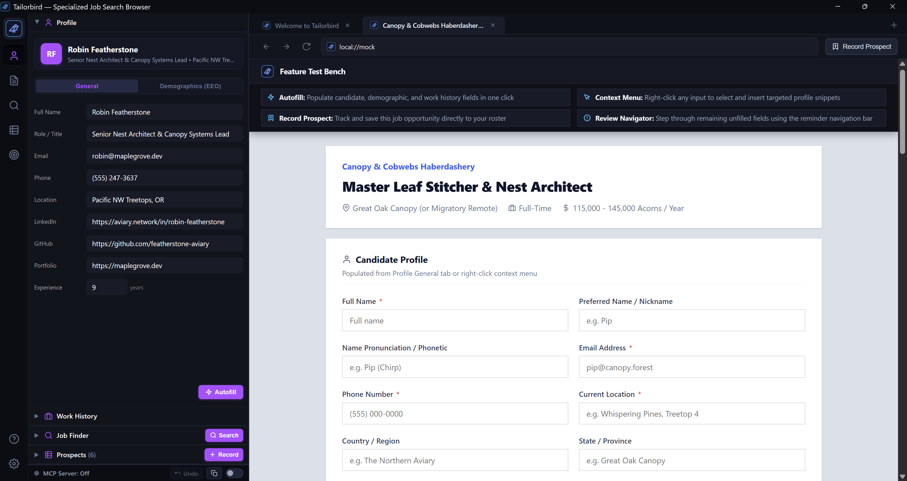
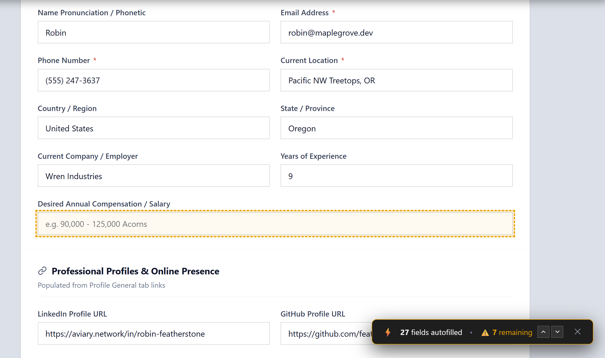
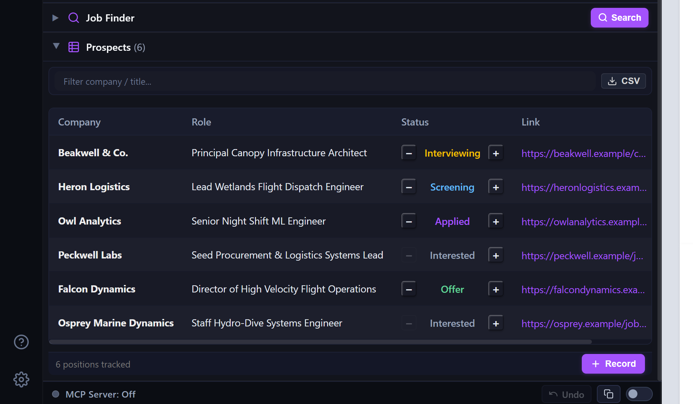
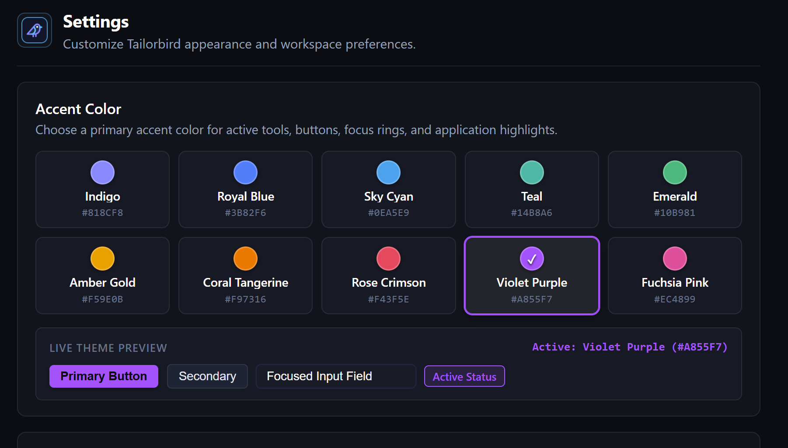

<div align="center">
  
  <h1>Tailorbird</h1>
  <p><strong>The Specialized Desktop Browser Built for the Job Search</strong></p>

  <p>
    <a href="https://github.com/joelstransky/Tailorbird/releases/download/v0.2.0/Tailorbird-Setup-v0.2.0.exe">Windows Setup</a> •
    <a href="https://github.com/joelstransky/Tailorbird/releases/download/v0.2.0/Tailorbird-macOS.dmg">macOS DMG</a> •
    <a href="https://github.com/joelstransky/Tailorbird/releases/download/v0.2.0/tailorbird-linux-x86_64.tar.gz">Linux tar.gz</a> •
    <a href="https://joelstransky.github.io/Tailorbird/">Website</a> •
    <a href="https://youtu.be/Uh7QckQQxEA">Video Tour (48s)</a>
  </p>
</div>

What if there was a tool to actually help with the job search?

**Tailorbird** attempts to simplify and organize your job search by bringing your candidate profile, 1-click form autofill, and application tracking directly into a dedicated, private browser.



---

## How It Works

### 1. Dual-Pane Workspace
Keep your reference notes, portfolio links, and complete work history locked right next to the application form.
- **Left Cockpit**: Pinned candidate profile, past positions, education, open-ended question snippets, job finder, pipeline tracker, and outreach roster.
- **Right Browser**: Full-featured web browser that renders any company career site or application form natively.
- **Adjustable Split**: Drag the divider to whatever width fits your screen, with persistent layout memory across sessions.

### 2. 1-Click Application Autofill
Stop typing your name, email, phone number, address, and profile links on every single company application.
- **Smart ATS Detection**: One-click fill detects common fields across top application systems—including Greenhouse, Lever, Ashby, Workday, Rippling, Workable, SmartRecruiters, BambooHR, and iCIMS.
- **Visual Highlighting**: Incomplete or required questions are highlighted so you never miss a submission detail.
- **Context Menu Paste**: Right-click any text box in the browser to paste custom bullet points, cover paragraphs, or portfolio URLs directly from your profile.



### 3. Prospects Pipeline
Track job opportunities as you discover them without switching to external spreadsheets.
- **Instant Save**: Click **Record Listing** (or press <kbd>Ctrl/Cmd</kbd> + <kbd>Shift</kbd> + <kbd>S</kbd>) on any active job page to capture the company name, role title, and posting URL immediately.
- **Stage Progression**: Move applications through stages—*Bookmarked*, *Applied*, *Screening*, *Interviewing*, *Offer*, or *Archived*.
- **CSV Export**: Export your complete pipeline to CSV at any time for your personal records or reporting.



### 4. AI Agent Control via MCP (Model Context Protocol)
Control your entire job search workflow directly from your favorite AI agent—including **Claude Desktop**, **Cursor**, **Windsurf**, **Antigravity**, **VS Code**, and **OpenCode**.

Tailorbird includes a built-in, local Model Context Protocol (MCP) server that exposes your candidate profile, work history, application prospects, and outreach roster directly to external AI coding and chat agents over HTTP/SSE.

- **Ask Your Agent to Research & Apply**: Tell your assistant, *"Find high-growth engineering roles at Falcon Dynamics and add them to my Tailorbird pipeline with screening notes."*
- **Auto-Tailor Resumes & Experience**: Let your agent analyze job descriptions and optimize your master work history or custom snippets directly in Tailorbird.
- **Full Safety & 1-Click Undo**: Every write action taken by an AI agent creates an automatic pre-write snapshot. Restore your exact workspace state with a single click of the **Undo** button in the app footer.
- **100% Local & Private**: The MCP server listens strictly on `http://127.0.0.1:42427/mcp`. Zero data leaves your machine or is routed to third-party clouds.

#### Quick Setup in Your Favorite AI Client

**Cursor, Antigravity, Windsurf, VS Code, & Zed** (`mcpServers` config):
```json
{
  "mcpServers": {
    "tailorbird": {
      "url": "http://127.0.0.1:42427/mcp"
    }
  }
}
```

**Claude Desktop** (`claude_desktop_config.json` via `mcp-remote` bridge):
```json
{
  "mcpServers": {
    "tailorbird": {
      "command": "npx",
      "args": ["-y", "mcp-remote", "http://127.0.0.1:42427/mcp"]
    }
  }
}
```

**OpenCode CLI** (`opencode.json`):
```json
{
  "$schema": "https://opencode.ai/config.json",
  "mcp": {
    "tailorbird": {
      "type": "remote",
      "url": "http://127.0.0.1:42427/mcp",
      "enabled": true,
      "oauth": false
    }
  }
}
```

#### Available MCP Tools
- `get_tailorbird_data`: Read profile details, work history, snippets, prospects, and outreach contacts.
- `update_candidate_profile`: Automatically update candidate fields (contact, location, links, demographics).
- `set_work_history`: Append or update career positions, accomplishments, and bullet points.
- `upsert_special_field`: Save tailored answers and reusable Q&A snippets.
- `add_prospect`: Capture new job postings with company, role, posting URL, and initial stage.
- `update_prospect_status`: Transition application stages (*Screening*, *Interviewing*, *Offer*).
- `add_outreach_card` & `update_outreach_card`: Manage networking targets, key contacts, and draft intro pitches.

### 5. Job Finder
Quickly search across 9 major ATS platforms using role keywords and location filters. Browse open postings directly in Tailorbird without opening separate search engines.

### 6. Outreach Roster
Proactively manage company networking, recruiters, and key contacts.
- Track target companies, interview leads, and follow-up timelines.
- Draft custom intro notes and value propositions.
- Copy outreach messages to your clipboard with one click.

### 7. Workspace Themes & Personalization
Tailor your workspace with your choice of accent colors to match your personal aesthetic.



---

## 100% Private & Offline-First

Your job search data belongs to you—period.
- **Zero Cloud Accounts**: No logins, passwords, or subscriptions required.
- **Local JSON Storage**: All profiles, tracked listings, and notes are saved directly on your computer in `tailorbird_data.json`.
- **No Tracking or Telemetry**: Your resumes, notes, and activity never leave your machine.

---

## Keyboard Shortcuts

Tailorbird includes standard browser shortcuts and quick actions for rapid job searching:

| Action | macOS | Windows / Linux |
| :--- | :--- | :--- |
| **Record Listing to Prospects** | <kbd>Cmd</kbd> + <kbd>Shift</kbd> + <kbd>S</kbd> | <kbd>Ctrl</kbd> + <kbd>Shift</kbd> + <kbd>S</kbd> |
| **New Tab** | <kbd>Cmd</kbd> + <kbd>T</kbd> | <kbd>Ctrl</kbd> + <kbd>T</kbd> |
| **Close Tab** | <kbd>Cmd</kbd> + <kbd>W</kbd> | <kbd>Ctrl</kbd> + <kbd>W</kbd> |
| **Focus Address Bar (Omnibar)** | <kbd>Cmd</kbd> + <kbd>L</kbd> | <kbd>Ctrl</kbd> + <kbd>L</kbd> |
| **Reload Tab** | <kbd>Cmd</kbd> + <kbd>R</kbd> | <kbd>Ctrl</kbd> + <kbd>R</kbd> / <kbd>F5</kbd> |
| **Back / Forward** | <kbd>Cmd</kbd> + <kbd>[</kbd> / <kbd>]</kbd> | <kbd>Alt</kbd> + <kbd>←</kbd> / <kbd>→</kbd> |
| **Next / Previous Tab** | <kbd>Ctrl</kbd> + <kbd>Tab</kbd> / <kbd>Shift</kbd>+<kbd>Tab</kbd> | <kbd>Ctrl</kbd> + <kbd>Tab</kbd> / <kbd>Shift</kbd>+<kbd>Tab</kbd> |
| **Switch to Tab (1–9)** | <kbd>Cmd</kbd> + <kbd>1</kbd> – <kbd>9</kbd> | <kbd>Ctrl</kbd> + <kbd>1</kbd> – <kbd>9</kbd> |

---

## Installation & Downloads

Official installers and portable releases are available on the [Releases page](https://github.com/joelstransky/Tailorbird/releases):

- **Windows**: Download and run [`Tailorbird-Setup-v0.2.0.exe`](https://github.com/joelstransky/Tailorbird/releases/download/v0.2.0/Tailorbird-Setup-v0.2.0.exe).
- **macOS**: Open [`Tailorbird-macOS.dmg`](https://github.com/joelstransky/Tailorbird/releases/download/v0.2.0/Tailorbird-macOS.dmg) and drag Tailorbird to Applications.
- **Linux**: Download [`tailorbird-linux-x86_64.tar.gz`](https://github.com/joelstransky/Tailorbird/releases/download/v0.2.0/tailorbird-linux-x86_64.tar.gz), extract, and run `./tailorbird`.

---

## License

Tailorbird is open source software released under the [MIT License](LICENSE).
